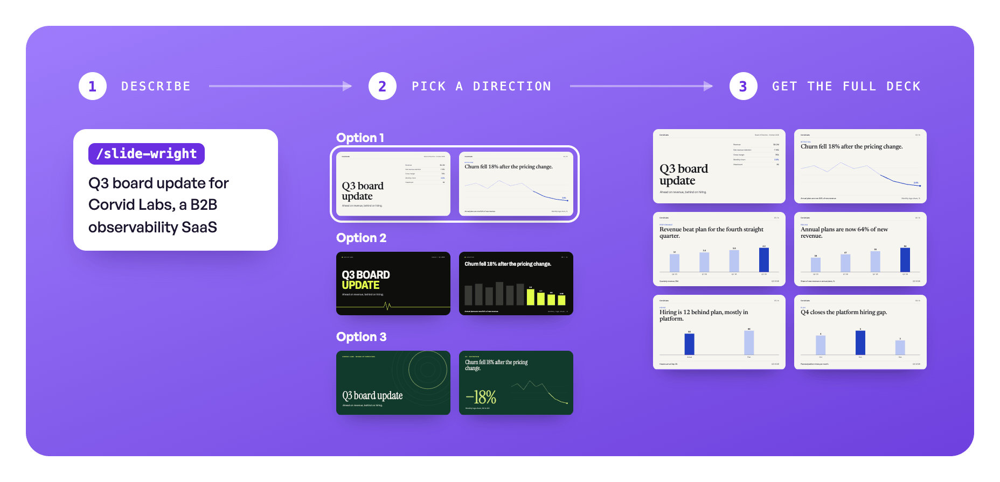
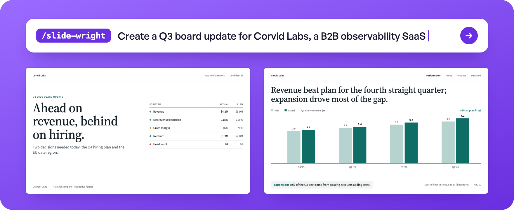
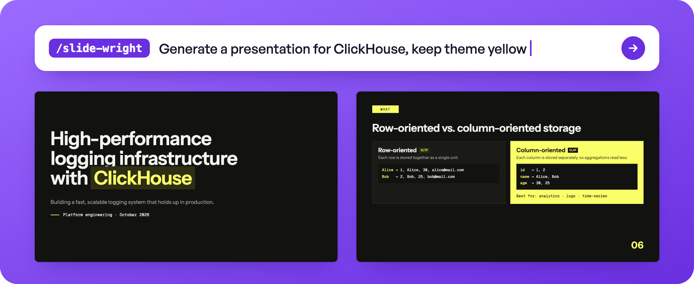

<h1 align="center">slide-wright</h1>

<p align="center">Make presentations with your coding agent</p>

<p align="center">
  <a href="https://github.com/arifszn/slide-wright/releases"></a>
  <a href="https://github.com/arifszn/slide-wright/actions/workflows/test.yml"></a>
  <a href="LICENSE"></a>
</p>

<p align="center">
  <a href="#quick-start">Quick start</a>
  ·
  <a href="#examples">Examples</a>
  ·
  <a href="#export-and-share">Export and share</a>
  ·
  <a href="#installation">Installation</a>
  ·
  <a href="#faq">FAQ</a>
</p>

slide-wright is an agent skill that turns a topic, rough notes or an outline into a presentation. It designs a new theme for every deck and shows you two real slides in each direction before it builds the rest.

The result is one HTML file. Present it in a browser, export it to PowerPoint or PDF, or deploy it to a live URL. slide-wright works in Claude Code, Codex, Cursor, OpenCode, Gemini CLI, Antigravity and other agents that support the `SKILL.md` format.

https://github.com/user-attachments/assets/911a77d8-fae4-48aa-81a0-594e675534c9

## Quick start

In Claude Code, add the marketplace and install the plugin:

```bash
/plugin marketplace add arifszn/slide-wright
```

```bash
/plugin install slide-wright
```

In any other agent:

```bash
npx skills add arifszn/slide-wright
```

Then ask for a deck:

```
/slide-wright Make me a deck about <your topic>
```

## How it works



1. **Describe the deck.** A topic, rough notes or a full outline.
2. **Answer two questions.** How many design directions to compare, and whether the slides should animate.
3. **Compare previews.** Each direction gets its own palette, type and layout, shown on the same two slides of your deck: the title slide and one content slide. The previews open in your browser.
4. **Pick one.** It builds the full deck in that direction. If none fits, ask for new directions, or ask to adjust one ("warmer", "a bolder accent").
5. **Use it.** Present it, change it later, export it or deploy it.

## What you get

- **A theme made for the deck**: palette, typography, layout and a visual motif taken from the subject. There is no template library.
- **Slides that make a point**: each content slide states one claim and backs it with a chart, flow, timeline, comparison, architecture diagram or metric panel, drawn in the theme's colors.
- **Speaker notes and a presenter view**, and animation if you choose it.
- **A layout check**: a script flags text that overflows, overlaps, is clipped or is smaller than 18px, and fonts that did not load. The agent fixes each one before it hands the deck over.
- **One self-contained HTML file**: no build step, and nothing to install to present it.

## Examples





![The prompt "Create a presentation on MCP with this outline: [outline]" above two slides: a title slide with a JSON-RPC request, and an architecture diagram of one host with three clients and servers](assets/example-mcp.png)

## Change a deck later


Point the agent at a deck and ask for the change: a new slide, a rewrite, a different chart. It skips the preview step, since the look is already set, and runs the layout check again afterwards. This works on any deck built on reveal.js, including ones slide-wright did not make.

## Present it

Open the HTML file in a browser. Move with the arrow keys, the space bar or a swipe.

| Key | Action |
| --- | --- |
| F | Fullscreen |
| Esc / O | Slide overview |
| S | Speaker view with notes |
| B / . | Pause to a black screen |
| ? | Show all keys |

## Export and share


### PowerPoint

Ask the agent, or run the exporter yourself. Text comes out as editable text boxes, with the speaker notes, and local videos are embedded. Shapes, charts and images are part of each slide's background picture: they look the same but are not editable. Fonts are not embedded, so on a machine without the deck's fonts PowerPoint substitutes similar ones. Use the PDF when exact typography matters. Animations are exported in their final state.

To run the exporter yourself (Node 18 or newer; it uses Chrome or Edge, and downloads Chromium on first run if neither is installed):

```bash
node <skill-dir>/scripts/export-pptx.mjs deck.html
```

`<skill-dir>` is the installed `slide-wright` folder.

### PDF

The agent walks you through the browser's print dialog. To do it yourself, add `?print-pdf` to the deck's URL and open the print dialog (Cmd/Ctrl + P). Save as PDF with Landscape layout, margins set to None and background graphics on.

### Live URL

The agent offers Surge, Vercel and Netlify and returns the URL. Each host needs a one-time login that you run in your own terminal; the agent gives you the command. To do it yourself, save the deck as `index.html` in an empty folder and upload the folder to any static host, such as GitHub Pages, Cloudflare Pages or S3.

## Installation

[Quick start](#quick-start) covers the plugin and npx installs. You can also paste this to any agent that supports the `SKILL.md` format:

```
Fetch and follow the install instructions from
https://raw.githubusercontent.com/arifszn/slide-wright/refs/heads/main/INSTALL.md
```

To copy the skill by hand, [INSTALL.md](INSTALL.md) lists the skills folder for each agent.

## FAQ

**Does it use templates?** No. It designs each theme from the deck's subject and audience. When you reject the previews, it makes new directions that differ in palette, type and layout, not recolors of the same one.

**Can I use my brand colors or fonts?** Yes. Put them in the prompt, as in "keep theme yellow" above, or ask it to adjust a preview.

**Does the deck work offline?** It needs a connection to load the slide engine and fonts. For an offline copy, export a PDF or PPTX.

## Contributing

Bug reports and pull requests are welcome. `npm test` runs the tests for the layout check and the PowerPoint exporter. After editing `slide-wright/SKILL.md`, run `tools/sync-root-skill.sh` to update the root copy; CI checks that they match.

If slide-wright saved you time, [give it a star](https://github.com/arifszn/slide-wright). A star helps other people find it.

## License

[MIT](LICENSE)
